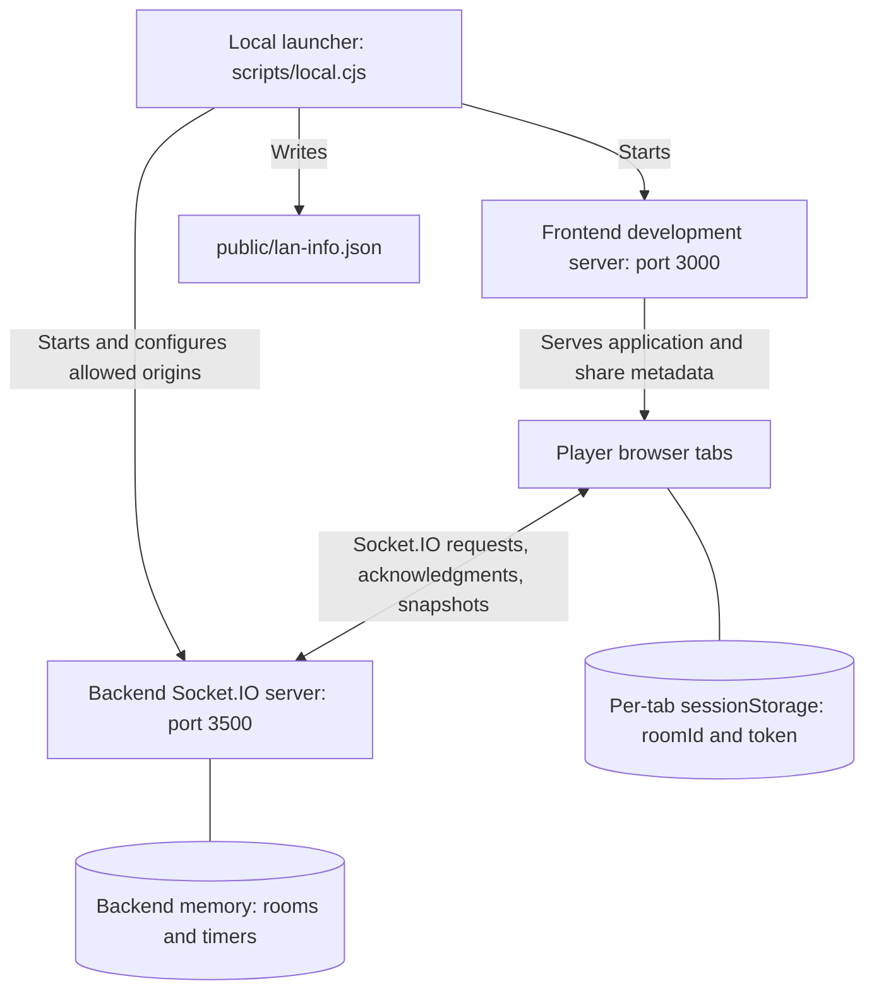
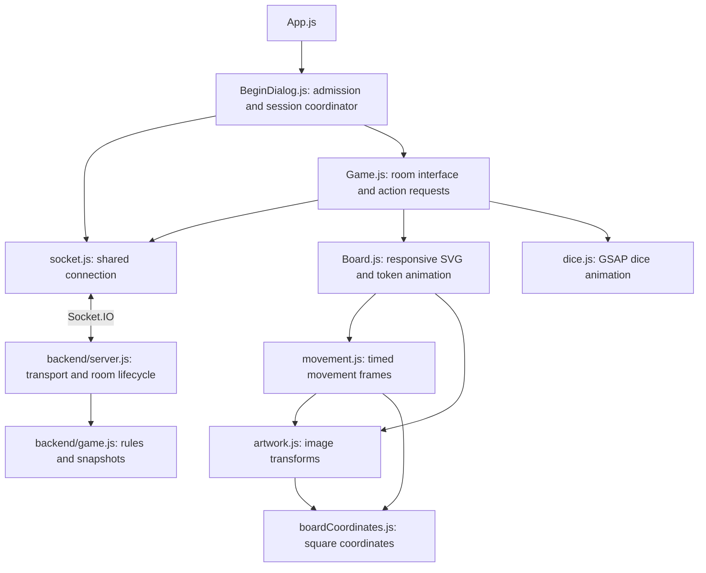
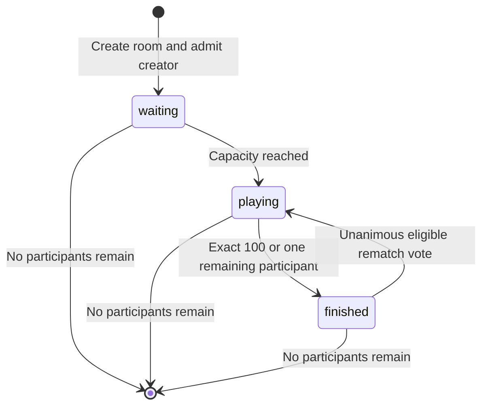
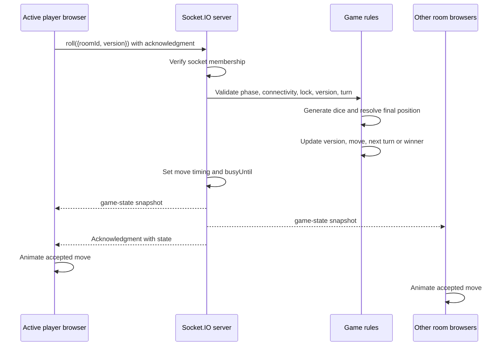
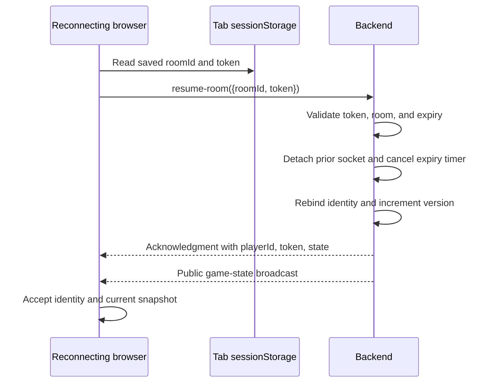

# Local multiplayer system architecture

## Scope and architectural approach

This document describes the implemented system across the frontend repository and the sibling `../snake-ladder_backend` repository. It is a server-authoritative, room-based application for 2–8 players on a local network. One backend process holds all rooms; every browser maintains a presentation copy of its room's latest public snapshot.

The main design choice is to exchange **action requests and complete snapshots**, rather than replay client-generated dice values. This centralizes rule enforcement and recovery: a recovering browser can render the latest state without replaying the full game history. The cost is that rooms disappear when the backend process stops, and play depends on the host remaining reachable.

## Runtime boundaries

The host computer serves assets and runs game logic in separate processes. Phones connect to both ports directly using the host’s local hostname (or LAN IP address). `lan-info.json` supports sharing links; it is not a room registry or source of game state. No database, REST API, or client-to-client game connection is implemented.

| Boundary | Owns | Does not decide |
| --- | --- | --- |
| Backend game rules | Positions, dice, turn, phase, winner, version, board transitions | Browser animation frames or layout |
| Backend transport/lifecycle | Membership, tokens, broadcasts, expiry timers, rematch votes, move timing | Browser rendering |
| Frontend session coordinator | Accepted identity, snapshot selection, recovery, connection status | Legal moves or room admission |
| Frontend presentation | Controls, board geometry, sound, animation, countdown display | Authoritative game outcomes |
| Local launcher | Child processes, LAN discovery, origin configuration, share metadata | Room membership or persistence |

## Source architecture

`BeginDialog` acts as the frontend session controller despite its name: it renders admission UI until identity and state are accepted, then passes `game`, `playerId`, connection status, and a leave callback into `Game`. It owns the `game-state` subscription and removes listeners on unmount. `Game` sends roll/rematch requests; leaving is delegated back to the session controller.

`Board` receives the snapshot as a prop and calculates presentation movement locally. It does not submit moves. `movement.js` constructs timed positions, `boardCoordinates.js` maps square numbers into SVG coordinates, and `artwork.js` aligns paths with the original images. `dice.js` handles dice presentation. Legacy files such as `Person.js`, `Ladder.js`, and `ResetButton.js` remain in the repository but are not part of the active `Game` rendering path.

On the backend, `server.js` owns Socket.IO handlers, socket membership, room storage, timers, publication, and rematch orchestration. `game.js` supplies room creation, admission, move validation/resolution, board maps, and token-free snapshots. This separates transport concerns from most game rules, although lifecycle mutations and animation timing still live in the server layer.

## Data model and storage

| Record | Key fields | Lifetime and visibility |
| --- | --- | --- |
| Room | `roomId`, `capacity`, `players`, `phase`, `turn`, `version`, `winnerId` | Backend memory; public fields copied into snapshots |
| Player | `id`, `position`, `connected`, `forfeited`, `disconnectedUntil` | Public player state; forfeited slots retained during a started game |
| Private membership | `socketId`, `token` | Backend player record; omitted from public snapshots |
| Move | `number`, `playerId`, `roll`, `from`, `landed`, `to`, `startedAt`, `diceMs`, `duration` | Latest move only; used for presentation and recovery |
| Coordination | `busyUntil`, `rematchVotes`, `serverTime` | Public timing/voting metadata |
| Browser session | `roomId`, `token` under `snake-ladder-session` | Per-tab sessionStorage; used to request identity restoration |

`turn` is an index into the room's player array; `playerId` is the stable identity used by clients. `version` advances for membership and lifecycle changes as well as moves. `lastMove.number` identifies the move independently of later metadata-only snapshots, preventing animation replay on reconnect or voting updates. Full move history is not stored.

## Ownership

The sibling backend owns capacities (2–8), admission, player IDs, private resume tokens, positions, dice values, active turn, phase, version, winner, disconnect deadlines, rematch votes and move timing. The frontend presents snapshots and requests actions. Rooms are memory-only.

The room lifecycle is `waiting` → `playing` → `finished`; unanimous rematch returns to `playing`. Creation also joins the creator. Codes are six hex characters generated with collision checks. Sockets cannot join two rooms. A game starts automatically at capacity.

Each admitted player has an unguessable random resume token. Public snapshots omit tokens and socket IDs. Resume validates token and expiry, then rebinds membership to the new socket. Any replaced socket is detached before disconnect, so its disconnect event cannot mark the restored player offline.

Disconnect pauses active play and reserves a slot for 120 seconds. The expiry timer forfeits it. Explicit leave immediately forfeits and removes the socket from the room. Waiting slots are removed, started-game slots are retained as forfeited for stable player numbering, and turn rotation skips them. A single remaining participant wins by forfeit. Empty rooms are deleted. Timers are canceled on resume/leave and server shutdown.

Rematch requires a finished game and at least two non-forfeited, connected players. Each player has one vote. All must agree; then forfeited slots are removed, capacity is set to the remaining count, and positions/turn/winner/last move/votes are reset. Player identities and tokens persist.

## Room and player lifecycle

Disconnection is a player condition, not a separate room phase. A room can remain `playing` while rolls are paused for an offline participant. Waiting-room departures remove the slot; started-game departures forfeit it so indexes remain stable until a rematch compacts the player list.

## End-to-end action flow

The server updates the final position before broadcasting. The browser's token can therefore be between squares while authoritative state already records its destination. `busyUntil` prevents another accepted roll during that presentation window. Requests rejected by validation receive `{ok:false,error}` without applying a move.

The frontend uses the broadcast subscription to update gameplay; roll/rematch acknowledgments clear pending status and expose errors. Admission/resume acknowledgments additionally establish private identity. These are distinct responsibilities, so receiving a public snapshot alone does not admit a browser as a player.

## Socket contract

All requests require an acknowledgment. Success is `{ok:true,...}`; failure is `{ok:false,error}`.

| Event | Request | Success data |
| --- | --- | --- |
| `create-room` | `{capacity}` | `{playerId,token,state}` |
| `join-room` | `{roomId}` | `{playerId,token,state}` |
| `resume-room` | `{roomId,token}` | `{playerId,token,state}` |
| `roll` | `{roomId,version}` | `{state}` |
| `leave-room` | `{roomId}` | No additional data |
| `rematch` | `{roomId}` | `{state}` |

`game-state` broadcasts the public snapshot after membership, connection, roll, expiry, leave and vote changes. Snapshots include room identity/capacity, players, phase, turn, monotonically increasing version, winnerId, lastMove, busyUntil, rematchVotes, board transitions and serverTime. Public players include id, position, connected, forfeited and (while offline) disconnectedUntil.

The server validates membership, current turn, playing phase, current version, connected participants and animation lock before rolling. Dice are crypto-generated 1–6. Overshoot stays put; snakes/ladders apply to the rolling player before advancing the turn. Six does not grant another turn. Exact 100 finishes play.

## Recovery and time

`BeginDialog` stores only roomId/token in sessionStorage, scoped to a browser tab. On every connection it resumes the saved membership before enabling play. Rejection clears the expired session and returns to entry. A manual reconnect button handles failed attempts. Socket listeners have cleanup. Stale and cross-room snapshots are ignored; acknowledged admission supplies the accepted player identity.

Client display deadlines are translated using serverTime, so phone/computer wall-clock differences do not change countdowns or move timing. Network latency can cause a small presentation offset; authoritative positions and roll locks remain on the server.

## Rendering and animation

`Board` draws a responsive SVG with a shared 1000×1000 coordinate system. Squares follow the serpentine path; the original ladder.png and Snake.png artwork and Font Awesome person icons all use board coordinates. Artwork landmarks are mapped to the transition endpoints using affine transforms. The original dice-face images occupy six fixed cube faces. A single forward GSAP spin decelerates over the server-specified 1.5 seconds and ends at the generated face orientation, without a reverse or return animation. Tokens wait for the initial 1.5-second roll, then move at 160 ms per square and traverse the original ladder/snake artwork over 700 ms. `lastMove` has number, playerId, roll, from, landed, to, startedAt, diceMs and duration. The backend sets busyUntil to serialize presentation before the next roll. A small settling interval follows movement.

The animation runs once per move number, catches up when joining/recovering mid-move, and cancels scheduled steps on replacement/unmount. Metadata snapshots do not replay movement. Reduced-motion preferences show final positions immediately. Snake movement follows sampled landmarks along the original image; ladder movement follows the artwork endpoints. The snapshot already contains final positions while tokens animate. During the resolving interval, the current player-list UI displays the moving player’s starting square; it switches to the final position when the interval ends.

## Local startup

`npm run local` starts both sibling repositories, detects IPv4 interfaces, supplies allowed frontend origins and writes ignored LAN share metadata. Ctrl+C stops the child process groups. Restart after network changes. No external deployment is required. Default separate backend startup also detects LAN origins; explicit FRONTEND_ORIGINS overrides them.

## Configuration and operational boundaries

| Setting | Owner | Default/meaning |
| --- | --- | --- |
| `REACT_APP_BACKEND_URL` | Frontend build/development environment | Overrides socket destination; otherwise development uses browser hostname on port 3500 and production uses page origin |
| `PORT` | Backend | 3500 for separate startup; launcher explicitly sets 3500 |
| `FRONTEND_ORIGINS` | Backend | Comma-separated allowed origins; the launcher supplies localhost, the detected local hostname, and LAN IPv4 addresses on port 3000; standalone backend startup defaults to localhost and LAN IPv4 addresses |
| `HOST`, frontend `PORT` | Launcher/frontend | Launcher binds the development server to `0.0.0.0:3000` |
| `homepage` | Frontend package configuration | Production asset base path; does not host or locate a backend |

Resume tokens are bearer credentials: possession allows restoration of the associated player. Room codes enable admission only while capacity is available. CORS configures allowed browser origins; membership checks and tokens enforce game actions and restoration. There is no account system or durable identity store.

The process-local room map and timers make this a single-backend-instance design. Multiple independent instances would not share membership, deadlines, or room versions. Persistence or multi-instance hosting would require an explicit shared state and coordination design.

## Verification architecture

Frontend unit/component tests cover admission, snapshot ordering, controls, geometry, movement and animation behavior. Backend rule tests exercise capacities, permissions, transitions and finish conditions. Socket.IO integration tests in `tests/` exercise the actual event boundary, including recovery and multi-player agreement. The README lists the commands; this documentation edit does not constitute a fresh test run.

## Limits

Recovery cannot survive a backend restart. Browser sessionStorage can be copied by tab duplication or lost when a tab closes. Reduced-motion changes made during a move apply on the next move. Background tab throttling may skip intermediate animation frames; final snapshots remain authoritative. Sound muting, health reporting and application request limits are implemented. Accessibility work, device testing and internet hosting are excluded. Persistent rooms remain optional.

## Sound preference

`Game` stores a muted boolean in localStorage and uses a ref in the roll-sound effect, so toggling sound does not replay the current move. Muting pauses and resets current audio immediately. Native audio muting also follows cross-tab storage changes. Storage access failures preserve in-memory controls. Playback rejection is caught so browser autoplay policy cannot break gameplay.

## Operational behavior

The backend attaches Socket.IO to an explicit Node HTTP server. `/health` returns an uncached availability response with uptime, room and connection counts; it exposes no room codes or credentials. Unknown HTTP routes return JSON 404 responses.

`operations.js` supplies `RequestError` for expected validation/rule failures and a fixed-window limiter. Every known action consumes both a connection budget (30/10 seconds) and an address budget (150/10 seconds), before checking the acknowledgment callback or executing an action. Failed budgets return retryAfterMs without invoking gameplay code. Server-factory options can override limits and windowMs for tests. Addresses are taken from the actual socket handshake, not a client-supplied payload/header. Expired address buckets are swept; socket buckets are removed on disconnect, and all buckets/timers are cleared on shutdown. Requests are capped at 16 KiB.

A structured logger records lifecycle events and request failures without payloads, resume tokens or addresses. Expected RequestErrors retain actionable client messages. Unexpected errors produce a generic client response and an error-level event with action, room and error type. Logger failures cannot interrupt gameplay. Rate-limit logging occurs only on the first exceeded request per budget window. SIGINT/SIGTERM close the server and release timers.

Tests cover sound persistence/cross-tab changes, health availability/counts, rate boundaries and recovery, shared address budgets, malformed input, internal-error handling and credential omission. Browser/device testing is outside the agreed scope.
