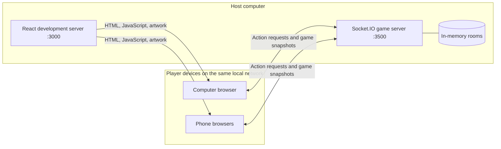

# Snakes and Ladders

A React game with a sibling `snake-ladder_backend` Socket.IO service. Private rooms support **2–8 players** on the same local network. No internet deployment is required.

## System overview

The system runs as two services on one computer: a React frontend on port **3000** and a Socket.IO backend on port **3500**. Each player opens the frontend in a browser on that computer or another device on the same Wi-Fi. The browser connects directly to the backend; the frontend development server does not relay game events.

The **backend is the source of truth**: it admits players, generates dice, applies movement rules, chooses the next turn, and manages disconnects and rematches. Browsers request actions and render the resulting snapshots. They animate a move that has already been accepted by the server; they do not decide its outcome.

For example, clicking the dice sends a `roll` request with the room ID and snapshot version. The backend checks membership and turn ownership, calculates the move, and broadcasts a new `game-state` to every player. Each browser then shows the same dice result and movement. The backend rejects further rolls until the shared animation window ends.

### Code map

| Area | Location | Responsibility |
| --- | --- | --- |
| Application shell | `src/index.js`, `src/App.js` | Mount React and apply the page shell. |
| Session and network coordination | `src/BeginDialog.js`, `src/socket.js` | Create/join/resume rooms, accept snapshots, store recovery credentials, and handle connection state. |
| Game interface | `src/Game.js` | Display room/turn status and request rolls, rematches, sharing, and leaving. |
| Board and dice presentation | `src/Board.js`, `src/dice.js`, `src/dice.css` | Render the SVG board, tokens, and animated dice. |
| Geometry and movement | `src/boardCoordinates.js`, `src/artwork.js`, `src/movement.js` | Convert squares and artwork landmarks into animation coordinates. |
| Local launcher | `scripts/local.cjs` | Start both services and generate LAN share-link metadata. |
| Network boundary | `../snake-ladder_backend/server.js` | Handle Socket.IO requests, membership, broadcasts, reconnect timers, and rematches. |
| Game rules | `../snake-ladder_backend/game.js` | Store room state, validate moves, resolve rules, and produce public snapshots. |

Room state lives in backend memory. Each browser tab stores only its room ID and private resume token in sessionStorage. Public snapshots exclude that token and socket IDs. There is no database or external service required for local play.

Read [DESIGN.md](DESIGN.md) for component boundaries, request sequences, state lifecycles, timing, and architectural tradeoffs.

## Start on your local network

1. Install dependencies with `npm ci` in this repository and `../snake-ladder_backend`.
2. From this repository run `npm run local`.
3. Open the printed computer URL. On phones, connect to the same Wi-Fi and open the printed phone URL.

The command starts both services, configures allowed origins for current IPv4 interfaces, and generates an ignored `public/lan-info.json` for the Share room link button. Stop both services with Ctrl+C. Ports 3000 and 3500 must be available. The repositories must be sibling directories.

Create a room, select the player count, and share its code or room link. Links prefill the code; each player selects Join Game. Play starts when the room fills. Keep the computer awake while playing.

### Troubleshooting

- If the page loads but joining fails, make sure both services are running, and use the same Wi-Fi without guest/client isolation. Permit local Node connections if your operating system firewall prompts you.
- After switching networks, restart `npm run local` so the phone URL and allowed origins refresh.
- Phones must use the computer’s printed Wi-Fi URL, rather than `localhost`.
- If ports are already occupied, stop the older game servers before starting the command.
- If there are multiple network adapters, use the computer’s Wi-Fi IPv4 address. Allowed origins include all detected IPv4 addresses; the first is used by the share button.

For separate startup, run `node server.js` in the backend and `npm start` here. The backend automatically allows localhost and detected IPv4 addresses on port 3000. `FRONTEND_ORIGINS` can override this with comma-separated origins; `PORT` overrides backend port 3500. `REACT_APP_BACKEND_URL` overrides the frontend connection URL. LAN share-link metadata is generated only by `npm run local`.

## Rules and movement

All tokens begin on square 1. The server generates dice values, applies snakes/ladders, and advances the turn. Six grants no extra turn. Overshooting 100 leaves the token in place and advances the turn. Land exactly on 100 to win.

The original dice-face artwork spins in 3D before the original person icon moves square by square, then follows the original ladder or snake artwork to its destination. Colored person icons and artwork remain aligned as the board resizes. The backend briefly locks new rolls while a move is being shown. Reduced-motion preferences display the destination immediately while preserving the common turn timing.

## Recovery, leaving and rematches

Player credentials are kept in **sessionStorage per browser tab**. Refreshing the same tab or reconnecting automatically restores identity, room, position, and turn. Do not share or copy these credentials; share only the room code/link. A new independent tab is a new player. Duplicating a tab may copy its session; in that case the restored connection replaces the previous socket.

A disconnected slot is reserved for **two minutes**, with a countdown for other players. Active play pauses until everyone returns or the disconnected slot expires. Expiry forfeits the slot; turn rotation skips it. Leaving forfeits immediately. Waiting-room departures release capacity. When only one non-forfeited player remains in a started game, that player wins. When none remain, the room is removed.

After finishing, each remaining connected player can select Play again. The rematch starts only after unanimous agreement and resets all remaining tokens, turn, dice, and winner. At least two remaining players are required. To create a fresh group, leave and create another room.

Rooms and reconnect credentials live in backend memory. **A backend restart clears them.** Refresh recovery preserves the game only while the same backend process is running. Reopening a closed tab may not retain sessionStorage, depending on the browser.

## Verification

- `CI=true npm test -- --watchAll=false --runInBand`: frontend admission, recovery, snapshot order, turn controls, movement paths, animation lifecycle and reduced-motion checks.
- `node --test ../snake-ladder_backend/game.test.js`: backend capacity, rules, permissions and terminal-state checks.
- `node --test tests/recovery.cjs`: real Socket.IO reconnect, token validation, socket replacement, pause, expiry, rematch voting, leaving, slot reuse and animation locking.
- `node tests/multiplayer.cjs`: four-player synchronized moves, admission/permission failures, turn rotation and winner broadcasting.
- `npm run build`: production build check; publication is outside the current scope.

Network tests bind temporary local ports. Tests use deterministic dice only in temporary test servers; the normal backend uses crypto-generated dice.

## Remaining P2 work

Sound controls, additional accessibility refinements and device testing, operational health/error reporting and rate limits remain. Responsive board coordinates and the requested player animation are implemented. Internet hosting is outside scope.

See [DESIGN.md](DESIGN.md) for the complete system architecture and protocol.
